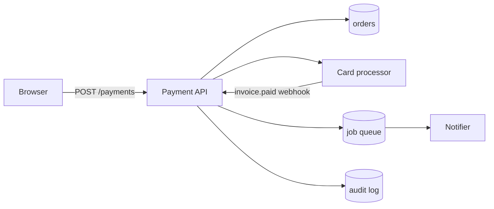

# Advanced Threat Modeling - Comprehensive Guide

## At a glance

Threat modeling is how you decide which threats deserve a control before the code hardens around the wrong assumption. You draw the system, mark where trust changes, name the threats on each crossing, and leave each one with a decision someone owns.

This guide runs that session on one payment API. CIA, AAA, STRIDE, Design by Action, Design by Component, and OTM all show up, but they show up as questions you ask on the same diagram, not as five separate writeups of the same bug.

---

## Learning outcomes

- Run a model: assets, data flow, trust boundaries, threats, rank, and what you still accept.
- Use STRIDE, CIA, and AAA as three questions about the same flow.
- Walk one business action and one component boundary and leave with a threat you can verify.
- Record the result as a ticket or an Open Threat Modeling entry, with an owner and a way to check the mitigation.

---

## Prerequisites

Auth, data flows, and the OWASP-style bug classes in the rest of this repo. Enough of a backend to follow a request from a browser to a processor webhook.

---

## What the work actually is

Adam Shostack's four questions are the whole job:

1. What are we building?
2. What can go wrong?
3. What are we going to do about it?
4. Did we do a good job?

Everything else is a way to answer those without lying to yourself. STRIDE is a prompt for question 2. CIA is a prompt for "gone wrong for whom." AAA is a prompt for "who is this actor, what may they do, and what record exists if they deny it." Design by Action and Design by Component are two ways to pick where you start. OTM is a file format for the answer, after you have one.

The artifact you leave with is small.

- A diagram of this change, not the whole company.
- Assumptions written as sentences. "The browser is hostile." "The processor webhook is a stranger until the signature checks out." "A JWT proves an account, not the right to every row that shares the table."
- A short threat list. Five good ones beat forty rows of "SQL injection on the database."
- For each threat: mitigate, accept, or needs a test. A name. A way you will know the control is real.

If you cannot point at those four things after the meeting, you had a workshop. You did not model anything.

---

## How a session runs

I do this in one sitting for a feature. An hour, maybe ninety minutes if the webhook is new. Quarterly all-day reviews that produce a spreadsheet nobody opens are how the practice got a bad name.

Who sits in the room: the engineer who will write the handler, someone who can contradict the diagram (another service owner, the person who actually talks to the processor), and whoever will own the tickets. Security facilitates. Security does not invent the architecture while the team watches.

What I refuse to model in that hour:

- Every user action the product has ever shipped. Checkout, refund, and the processor webhook. Not "view product."
- Every box on the infra diagram. The payment API, the orders table, the processor, the queue. Not the CDN in front of the marketing site.
- Generic catalogues. "Apply STRIDE to the database" is how you get "information disclosure" as a finding with no path.

Scope is a decision. Write it at the top. "In: `POST /payments`, the charge to the processor, the `invoice.paid` webhook, tenant isolation on `orders`. Out: card-processor internals, the marketing site, load testing the edge."

A useful rule I stole from assessments: if you cannot name the interface, it is not in scope.

---

## Draw it first

You cannot STRIDE a paragraph. You STRIDE a diagram.

I use a data flow diagram because it forces the crossings. Four symbols, and I do not add a fifth unless I am lost.

| Symbol | Meaning | On this payment API |
| --- | --- | --- |
| External entity | Something outside your process that sends or receives data | Browser. Card processor. |
| Process | Code that transforms data | Payment API. Notifier worker. |
| Data store | Data at rest | `orders`. Audit log. Job queue. |
| Data flow | An arrow with a name | `POST /payments`. Processor charge. `invoice.paid` webhook. |

Trust boundaries are the lines where the story you tell yourself stops being true. On this system I mark four, and I write them as assumptions because that is what they are.

1. Browser to API. Anything in a header, query string, or JSON body is hostile, including a user id the client swears is its own, and including `amount`.
2. API to the card processor. The processor is outside your trust. Its webhook is a stranger until the signature checks out.
3. Queue to worker. A message is data. A URL inside it is not an instruction to fetch.
4. Tenant to tenant. A logged-in session proves an account, not the right to order 4413.



Assets worth naming before you list threats, in sentences, not labels.

- Card data and tokens: the processor should see them. Your logs should not. Confidentiality.
- Order price and refund amount: the client does not get to pick these. Integrity.
- The charge path itself: if `POST /payments` is down, you are not taking money. Availability.
- The audit row that says who moved money: if it can be edited, repudiation is free. Accounting.

I write the assumptions next to the arrows. "VPC peers are trusted" is the one that usually fails, so I do not let it sit unspoken. If the payment API calls the processor over the public internet, say that. If the worker runs on a shared cluster, say that too.

Do not skip this section because you "already know the architecture." The diagram is where the team discovers they disagree.

---

## STRIDE on that diagram

STRIDE is per element, not per product. Microsoft's docs treat it that way and they are right. You stand on a process, a store, or a flow, and you ask six questions. You do not open a blank spreadsheet and fill every cell.

| Letter | Question on this element | Control direction |
| --- | --- | --- |
| S Spoofing | Who is this, and what would a fake one look like? | AuthN, mTLS, webhook signatures |
| T Tampering | What could change in flight or at rest? | Integrity checks, HMAC, TLS, server-side totals |
| R Repudiation | Can they deny they did it? | Signed audit logs, WORM storage |
| I Information disclosure | Who else can read this? | Encryption, least privilege, redaction |
| D Denial of service | How do they stop everyone else? | Rate limits, quotas, timeouts |
| E Elevation of privilege | What can they do that they should not? | AuthZ, object-level checks, tenant filters |

I do not run all six on every box. A static asset store does not need a spoofing novella. The payment API, the webhook, and the `orders` table do.

Here is STRIDE on the diagram above, the threats I would actually write down. CIA and AAA sit in the last two columns so you can see they are the same finding, named three ways.

| Element | STRIDE | Threat I would write | CIA property that fails | AAA question that was skipped |
| --- | --- | --- | --- | --- |
| Flow: `POST /payments` body | T | Client `amount` is charged as-is | Integrity of the charge | Authorization of the amount (server never decided) |
| Flow: `POST /payments` | E | Pay for order 4413 while logged in as the owner of 4412 | Integrity, and confidentiality of 4413 | Authorization of the object |
| Flow: `invoice.paid` webhook | S | Anyone who can POST to the webhook URL marks an invoice paid | Integrity of order status | Authentication of the processor |
| Store: audit log | R / I | PAN or raw card token lands in the log line, or an admin edits the row | Confidentiality of card data; integrity of the trail | Accounting that cannot be rewritten |
| Process: Payment API | D | Caller retries a 500 and the processor sees twenty charges | Availability of the processor; integrity if duplicates land | (rate and idempotency, not an identity gap) |

That table is the model. The sections below unpack CIA and AAA on the same rows. They do not invent a second list.

---

## Which CIA property fails

CIA is three properties of a thing you already named. It is not a catalogue of every bug that has ever existed.

- Confidentiality: who is allowed to read this.
- Integrity: who is allowed to change this, and how you would notice.
- Availability: who is allowed to stop this.

Ask them of a flow or a store, and add "for whom." Card tokens leaking to a support engineer is a different finding from card tokens leaking to another tenant. "PII must be protected" is a requirement document. "The notifier must not put PAN in the receipt email" is a threat.

On the payment API:

**Confidentiality.** The processor sees the charge. The API sees a token. The audit log sees `orderId`, `userId`, last four, and a processor id. If a 500 handler dumps the request body, confidentiality is gone and nobody needed SQL injection to get there. Same property if tenant 4412 can `GET /orders/4413`.

**Integrity.** The amount charged must be the stored order total, not the number in the JSON. Order status must move `pending -> paid` because the processor said so, not because a stranger hit the webhook. A refund must not exceed the captured amount. Those are integrity threats that look like business rules. They are still threats.

**Availability.** `POST /payments` has to work during a sale. The cheap DoS is not a SYN flood. It is "retry on 500 with no idempotency key," or "let the client pick `quantity=999999`," or "the processor timeout is 30s and we hold a worker the whole time." Availability here is an engineering property of the charge path, not a CDN checkbox.

I do not score Confidentiality of PII as CRITICAL because a matrix told me both axes were High. I say: if this lands, we have a PCI finding and we reissue tokens. That sentence is the impact. The matrix can wait.

CIA of the *system* is in play too. The API's config (processor secret, signing key) is a confidentiality asset. The deploy pipeline that can change that config is an integrity asset. If you only encrypt columns and never ask who can `kubectl edit`, you modeled the table and missed the box that writes to it.

---

## AAA of the actor

AAA is the actor on the flow you drew. Three questions.

- Authentication: what proves this is who it claims to be.
- Authorization: what that principal may do to *this* object, right now.
- Accounting: what record exists if they later say they did not.

Users are the obvious actor. They are not the only one.

On `POST /payments` the browser presents a JWT. That is authentication of a person. It does not authorize `amount`, and it does not authorize `orderId` 4413. I have watched teams add MFA to login and still take `amount` from the body. MFA answered a spoofing question. The tampering question was still open.

The card processor is an actor. The webhook must authenticate the processor (signature, shared secret, mTLS, whatever they document). Then authorize the event: this `invoice_id` belongs to us, this amount matches, this event has not been applied. Then write an accounting row you cannot quietly delete. If you skip the first step, anyone who finds the URL can mark invoices paid. That is spoofing of a service, and it is an AAA miss.

Service-to-service is the same three questions. Payment API calling the processor: the API authenticates itself (API key, mTLS client cert). The processor authorizes that key to charge, not to refund another merchant. Your side logs the request id you sent. "It is inside the VPC" is not authentication. It is an assumption, and you already wrote it next to the arrow or you forgot.

Tenants are an authorization boundary, not a network one. Two customers sharing `orders` is the common case. The check is `WHERE id = :orderId AND tenant_id = :current_tenant`. A role of `customer` does not do that work. RBAC answers "which verbs." Object-level authorization answers "which row."

Accounting is where people get lazy. "We log everything" is not a model. I want: payment attempts (success and fail), who, which order, which amount you *intended*, which amount the processor captured, request id. I want those rows in a store the payment API's database role cannot UPDATE. If the same admin who can refund can also edit the log, repudiation is a policy, not a control.

---

## Design by Action

Design by Action starts from what the system *does*. Checkout. Refund. Export. You walk the steps of one operation and you ask STRIDE, CIA, and AAA at each step.

The current trap, and I have written the trap into older versions of this page, is to list every action the product has. User registration, add to cart, profile update, password reset, health check. That list is a product tour. It is not a model.

Pick the actions that can move money, change identity, cross a tenant line, or dump data. Three is a good number for a feature review. One is enough if the feature is "add Apple Pay to checkout."

How I pick:

- Business damage if it goes wrong. Payment beats "update display name."
- Data that should not leak. Export and admin tools beat public catalog.
- New or newly exposed. A webhook you did not have last quarter beats a path you modeled last month and did not change.
- Compliance that names the action. "Right to export" is an action. "We have GDPR" is not.

### The payment action, walked

Action: charge an order.

1. Browser sends `POST /payments` with `orderId`, `paymentMethodId`, and (today) `amount`.
2. API authenticates the JWT.
3. API loads the order.
4. API calls the processor with a charge.
5. API writes the transaction and order status.
6. API enqueues a receipt.
7. Processor later POSTs `invoice.paid`.

I do not STRIDE all seven with equal love. Steps 1, 3, 4, and 7 are where trust changes. Step 6 is interesting only if the receipt can contain a PAN or a token.

| Step | What can go wrong | CIA | AAA gap | What I would do |
| --- | --- | --- | --- | --- |
| 1 Body | Client `amount` charged | Integrity | Server never authorized the amount | Ignore client amount. Charge `orders.total`. |
| 3 Load order | Order 4413 paid by owner of 4412 | Integrity, confidentiality | No object-level check | `tenant_id = current_user.tenant_id` and status is `payable`. |
| 4 Processor | Secret in env dumped on 500; retries duplicate charges | Confidentiality, integrity | AuthN of *our* client to them is fine; we lack idempotency | Processor secret from a manager, not a log. Idempotency key = `orderId`. |
| 7 Webhook | Unsigned POST marks paid | Integrity | Processor not authenticated | Verify signature. Match amount. Reject replays. |

Four threats. Each has a control I can describe to the engineer in one sentence. That is a session.

### Action notes I actually keep

```markdown
## Action: Charge order

What it does: take a stored total and capture it at the processor.

In scope: POST /payments, processor charge, invoice.paid webhook.
Out of scope: processor internals, the marketing site, adding a new payment method.

Assumptions:
- Browser is hostile.
- JWT proves a tenant, not an order.
- Processor webhook is untrusted until the signature verifies.
- Queue payload is data.

Threats we will act on:
- Client amount trusted. Owner: payments-api. Check: POST with mismatched amount returns 409. Ticket PAY-1882.
- Cross-tenant orderId. Owner: payments-api. Check: as tenant A, POST for tenant B's order returns 404. Ticket PAY-1883.
- Unsigned webhook. Owner: payments-api. Check: POST to /webhooks/processor with a bad signature returns 401. Ticket PAY-1884.

What we still accept:
- Processor can be slow. We time out at 8s and mark the order `unknown` for a reconcile job. Owner: payments-api. Review in 30 days.
```

Owner, check, ticket. If a row cannot grow those three, it is a wish. Put it under "what we still accept" or delete it.

---

## Design by Component

Design by Component starts from what the system *is*. Boxes and the arrows between them. You use it when the risk lives in a boundary, a protocol, or a store, not in a user journey. Microservices, a new queue, a new admin app, a shared database.

Same trap as actions: do not model the CDN, the internal dashboard nobody can reach from the internet, and the health checker. Model the components that sit on a trust boundary or that hold the data you named as assets.

How I pick a component:

- It crosses a boundary you already drew. API gateway, webhook handler, worker that reads a queue.
- It holds or transforms an asset. `orders`, the processor secret, the audit log.
- It can mint or check identity. Auth service, token signer.
- It is new. New store, new vendor, new runtime.

You can, and often should, use both views on one change. The action tells you "charge order" is in scope. The component view tells you the webhook handler is a separate process with its own auth story, and the worker is a separate identity. Cross-check. Do not write the amount-tampering finding twice.

### Components on the payment diagram

I would sit on three.

**Payment API.** Faces the browser. Parses JSON. Holds the processor key. Writes `orders` and the audit log. STRIDE here is the table in the STRIDE section. CIA: the secret and the payloads. AAA: JWT in, object-level checks, audit out.

**Card processor (external).** You do not model Stripe's internals. You model *your use* of it: how you authenticate, what you send, how you treat the webhook, what you do when it is down. Shared responsibility is an assumption. Write it.

**Notifier worker.** Reads the queue. Sends email. The threat that is unique to this box is "the queue message is an instruction." If the payload contains a URL the worker fetches, you just grew an SSRF surface that checkout never had. If it contains PAN because the API copied the request body into the job, confidentiality moved from a log line to a Redis dump.

I would skip the CDN. I would skip "PostgreSQL" as a box of its own unless this change adds a new cluster or a new role. The `orders` store is already on the diagram. The threats are "who can SELECT" and "who can UPDATE the audit table," which are properties of roles, not of the brand of database.

### Component notes I actually keep

```markdown
## Component: Processor webhook handler

Where it sits: internet -> TLS -> /webhooks/processor -> Payment API process.
Trust boundary: processor to API. The caller is not a user.

Technology: same process as POST /payments today. That is a smell. A separate
route still shares the deploy and the secret store.

Assumptions:
- Anyone who can reach the URL will POST to it.
- The processor signs the body with a key we store in the secret manager.
- Replays of a valid body are possible.

Threats we will act on:
- Unsigned or badly signed body accepted. Owner: payments-api. Check: 401 on
  bad signature. Ticket PAY-1884.
- Valid body applied twice. Owner: payments-api. Check: second POST of the
  same event id is 200 and does not recapture. Ticket PAY-1885.

What we still accept:
- Handler shares a process with the user-facing API. If we split it, we will
  model the new identity. Owner: platform. Not this sprint.
```

Notice the webhook showed up in the action walk *and* here. That is fine. One ticket. Do not double-count it in a risk register because two methods found it.

---

## Rank it, then write it down

Risk = Impact x Likelihood is a slogan that produces `likelihood: 50` and `impact: 100` and a dashboard nobody believes. I still rank. I just refuse to pretend the number is a measurement.

Impact in the business's words.

- "We charge the wrong amount" -> refunds, chargebacks, a processor review.
- "Tenant A sees tenant B's order" -> contract issue, maybe a reportable event depending on what is on the order.
- "Webhook is a public 'mark paid' button" -> free orders.
- "PAN in logs" -> PCI scope expansion this quarter.

Likelihood is the assumption that makes it easy.

- Amount is in the JSON today, and there is no server check. That is not "50." That is "the bug is already deployed."
- Webhook signature is implemented. Replays are not. Likelihood of replay is "anyone who can sniff or retry," which for a partner callback is higher than you want to admit.
- Cross-tenant check exists in `GET /orders/:id` and was forgotten on `POST /payments`. Likelihood is "the next curious customer," which is how IDORs ship.

Then a decision.

| Threat | Decision | Owner | How we will know |
| --- | --- | --- | --- |
| Client amount trusted | Mitigate this sprint | payments-api | Test: mismatched amount -> 409. Ticket PAY-1882 |
| Cross-tenant orderId | Mitigate this sprint | payments-api | Test: tenant A, order B -> 404. Ticket PAY-1883 |
| Unsigned webhook | Mitigate this sprint | payments-api | Test: bad signature -> 401. Ticket PAY-1884 |
| Webhook replay | Mitigate this sprint | payments-api | Test: second event id does not recapture. PAY-1885 |
| Processor slowness | Accept for 30 days | payments-api | Timeout 8s, reconcile job, calendar reminder |

A mitigation with no owner is a wish. A mitigation with an owner and no check is a story you will tell in the next incident review. The check can be a unit test, a contract test, a canary assertion, or a log query you actually run. "We'll be careful" is not a check.

### OTM after the thinking

[Open Threat Model](https://github.com/iriusrisk/OpenThreatModel) is a YAML (or JSON) file you can put in git. It is not a method. It will not find the amount bug for you. It will let a later tool, or a later person, parse what you already decided.

I record the threats from this session, not a catalogue of CWE. I do not invent a `riskReduction: 80` field and then fail the build on a made-up threshold. If a pipeline looks at this file, the useful checks are: valid document, every threat has an owner, every "mitigate" row has a ticket id. That is lint. It is still more honest than generating SAST rules from a diagram.

```yaml
otmVersion: "0.2.0"
project:
  name: "Checkout payment"
  id: "checkout-pay-v3"
  owner: "payments-api"
  attributes:
    in_scope: "POST /payments, processor charge, invoice.paid webhook"
    out_of_scope: "processor internals, marketing site"
assets:
  - name: "Payment API"
    id: "asset-pay-api"
    type: "process"
  - name: "orders"
    id: "asset-orders"
    type: "data-store"
  - name: "Processor webhook"
    id: "asset-webhook"
    type: "process"
threats:
  - name: "Client-supplied amount charged as-is"
    id: "threat-amount-tamper"
    description: "POST /payments takes amount from the body. A caller who owns order 4412 can charge 1.00 against a 240.00 cart."
    categories: ["Tampering"]
    cwes: ["CWE-345"]
    attributes:
      owner: "payments-api"
      ticket: "PAY-1882"
      check: "POST with mismatched amount returns 409"
      decision: "mitigate"
  - name: "Unsigned processor webhook marks invoice paid"
    id: "threat-webhook-spoof"
    description: "POST /webhooks/processor with any JSON body sets order status to paid."
    categories: ["Spoofing"]
    cwes: ["CWE-345"]
    attributes:
      owner: "payments-api"
      ticket: "PAY-1884"
      check: "POST with a bad signature returns 401"
      decision: "mitigate"
mitigations:
  - name: "Charge the stored order total"
    id: "mit-amount-server"
    description: "Ignore client amount. Capture orders.total. Ticket PAY-1882."
  - name: "Verify processor signature"
    id: "mit-webhook-sig"
    description: "HMAC of the raw body with the processor secret. Ticket PAY-1884."
```

Put the file next to the service, in the same repo, on the same PR as the handler change. A threat model that lives in a wiki two clicks away from the code is how models rot.

---

## When the shape changes

The method does not change. The diagram does. I stop writing a new "threat modeling for X" chapter for every stack. Four shapes come up constantly. Each one is a boundary you probably forgot to draw.

**Service to service is not the VPC edge.** Two pods in one cluster still need to prove who they are. Network policy is a reduce-the-blast-radius control. It is not authentication. If payment API can be called by anyone on the mesh, you modeled a gateway and missed east-west. mTLS or a bound token between services is the AuthN answer. Object-level checks inside the callee are still the AuthZ answer. I have seen "internal" payment endpoints that trusted `X-User-Id` from the caller. That header is the browser all over again.

**An object id is an authorization boundary.** `GET /api/users/{id}` and `POST /payments` with `orderId` are the same class. The identifier in the request is a claim, not a permission. Design by Action will catch this if you walk the load-object step. Design by Component will catch it if you sit on the API and ask Elevation. If your model says "RBAC: customer role" and never mentions the row, you missed it.

**Cloud shared responsibility is an assumption you write down.** AWS encrypts the disk if you turn it on. AWS does not check that tenant A cannot read tenant B's object in *your* table. IAM of the role your pod assumes, bucket policies, and who can `sts:AssumeRole` belong on the diagram as an external entity called "our cloud account." If a contractor's laptop can impersonate the payment role, confidentiality of every charge token is a people problem with an IAM shape. Do not bury it under "cloud provider security."

**A phone is hostile storage.** Tokens in app storage, logs on a rooted device, a reverse-engineered client that sends `amount`. Treat the mobile app as a browser with a nicer UI. The API still decides. Certificate pinning is a tampering control on the channel, not a reason to trust the client.

If a new shape appears (LLM with a tool, a partner SFTP drop, an admin impersonation switch), draw it, mark the boundary, run STRIDE on the new arrows. You already know how.

---

## Keep the model alive

A model is stale when the diagram is stale. Triggers I actually use:

- New external entity: webhook, partner API, admin tool, mobile client.
- New store or a new column that holds money, identity, or a secret.
- A security incident, even a near miss. If the unsigned webhook was hit in staging, the model that said "we verify signatures" was a lie.
- A processor or cloud IAM change.

I attach the OTM file, or a short markdown note like the action template, to the same PR as the handler. Reviewers can argue with the assumption in the same place they argue with the code. That is the opposite of a quarterly board.

Mitigations go in the backlog the team already uses. If PAY-1882 is not a ticket, it is not a mitigation. If the ticket has no test, it will regress the first time someone "simplifies" the handler.

Did we do a good job? Question 4. I answer it with the checks in the table, not with a completeness score. Can a new engineer find the diagram. Can they see which threats are still accepted. Can they run the tests. If those are yes, the model is doing work. If the answer is a 40-page PDF in a SharePoint folder from 2023, start over on the next feature and keep it short.

---

## Interview clusters

- Fundamentals: "What is STRIDE?" "What diagram do you start from?" "What do you refuse to put in scope?"
- Senior: "How do you rank if you will not multiply two numbers?" "Who owns mitigations?" "Show me a threat you accepted."
- Staff: "How does this not become a central bottleneck for 500 teams?" "When is a model theater?"

Theater is a model whose mitigations are not engineering work. If you cannot name the ticket, you are performing.

---

## Cross-links

Product Security Real-World Scenarios, Risk Prioritization, Secure Design / Zero Trust, Agile Security Compliance (evidence), Authorization and Authentication.

---

## References

- [OWASP Threat Modeling](https://owasp.org/www-community/Threat_Modeling)
- [STRIDE, per element](https://learn.microsoft.com/en-us/azure/security/develop/threat-modeling-tool-threats)
- [Open Threat Model spec](https://github.com/iriusrisk/OpenThreatModel)
