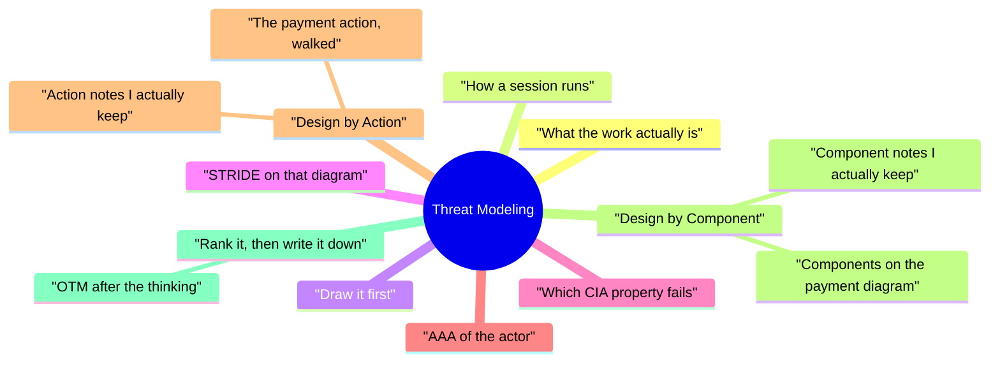

# Threat Modeling revision map

Threat Modeling in one sitting. That is the deal. I mined Threat Modeling - Critical Clarifications.md, Advanced Threat Modeling - Comprehensive Guide.md, Threat Modeling - Interview Questions.md, Threat Modeling - Quick Reference.md. The outline keeps every H2 I cared about from those files.

## What the work actually is
- Adam Shostack's four questions are the whole job:
- What are we building?
- What can go wrong?
- What are we going to do about it?
- Did we do a good job?
- A diagram of this change, not the whole company.
- Assumptions written as sentences. "The browser is hostile." "The processor webhook is a stranger until the signature checks out." "A JWT proves an account, not the right to every row that shares the table."
- A short threat list. Five good ones beat forty rows of "SQL injection on the database."

## How a session runs
- I do this in one sitting for a feature. An hour, maybe ninety minutes if the webhook is new. Quarterly all-day reviews that produce a spreadsheet nobody opens are how the practice got a bad name.
- What I refuse to model in that hour:
- Every user action the product has ever shipped. Checkout, refund, and the processor webhook. Not "view product."
- Every box on the infra diagram. The payment API, the orders table, the processor, the queue. Not the CDN in front of the marketing site.
- Generic catalogues. "Apply STRIDE to the database" is how you get "information disclosure" as a finding with no path.

## Draw it first
- You cannot STRIDE a paragraph. You STRIDE a diagram.
- I use a data flow diagram because it forces the crossings. Four symbols, and I do not add a fifth unless I am lost.
- Browser to API. Anything in a header, query string, or JSON body is hostile, including a user id the client swears is its own, and including amount.
- API to the card processor. The processor is outside your trust. Its webhook is a stranger until the signature checks out.
- Queue to worker. A message is data. A URL inside it is not an instruction to fetch.
- Tenant to tenant. A logged-in session proves an account, not the right to order 4413.
- Card data and tokens: the processor should see them. Your logs should not. Confidentiality.
- Order price and refund amount: the client does not get to pick these. Integrity.

## STRIDE on that diagram
- I do not run all six on every box. A static asset store does not need a spoofing novella. The payment API, the webhook, and the orders table do.
- Here is STRIDE on the diagram above, the threats I would actually write down. CIA and AAA sit in the last two columns so you can see they are the same finding, named three ways.

## Which CIA property fails
- CIA is three properties of a thing you already named. It is not a catalogue of every bug that has ever existed.
- Confidentiality: who is allowed to read this.
- Integrity: who is allowed to change this, and how you would notice.
- Availability: who is allowed to stop this.

## AAA of the actor
- AAA is the actor on the flow you drew. Three questions.
- Authentication: what proves this is who it claims to be.
- Authorization: what that principal may do to this object, right now.
- Accounting: what record exists if they later say they did not.

## Design by Action
- Design by Action starts from what the system does. Checkout. Refund. Export. You walk the steps of one operation and you ask STRIDE, CIA, and AAA at each step.
- Pick the actions that can move money, change identity, cross a tenant line, or dump data. Three is a good number for a feature review. One is enough if the feature is "add Apple Pay to checkout."
- Business damage if it goes wrong. Payment beats "update display name."
- Data that should not leak. Export and admin tools beat public catalog.
- New or newly exposed. A webhook you did not have last quarter beats a path you modeled last month and did not change.
- Compliance that names the action. "Right to export" is an action. "We have GDPR" is not.

### The payment action, walked
- Browser sends POST /payments with orderId, paymentMethodId, and (today) amount.
- API authenticates the JWT.
- API loads the order.
- API calls the processor with a charge.
- API writes the transaction and order status.
- API enqueues a receipt.
- Processor later POSTs invoice.paid.

### Action notes I actually keep
- Owner, check, ticket. If a row cannot grow those three, it is a wish. Put it under "what we still accept" or delete it.

## Design by Component
- Same trap as actions: do not model the CDN, the internal dashboard nobody can reach from the internet, and the health checker. Model the components that sit on a trust boundary or that hold the data you named as assets.
- It crosses a boundary you already drew. API gateway, webhook handler, worker that reads a queue.
- It holds or transforms an asset. orders, the processor secret, the audit log.
- It can mint or check identity. Auth service, token signer.
- It is new. New store, new vendor, new runtime.

### Components on the payment diagram
- See the source section `Components on the payment diagram` for the worked example.

### Component notes I actually keep
- Notice the webhook showed up in the action walk and here. That is fine. One ticket. Do not double-count it in a risk register because two methods found it.

## Rank it, then write it down
- Risk = Impact x Likelihood is a slogan that produces likelihood: 50 and impact: 100 and a dashboard nobody believes. I still rank. I just refuse to pretend the number is a measurement.
- "We charge the wrong amount" -> refunds, chargebacks, a processor review.
- "Tenant A sees tenant B's order" -> contract issue, maybe a reportable event depending on what is on the order.
- "Webhook is a public 'mark paid' button" -> free orders.
- "PAN in logs" -> PCI scope expansion this quarter.
- Amount is in the JSON today, and there is no server check. That is not "50." That is "the bug is already deployed."
- Webhook signature is implemented. Replays are not. Likelihood of replay is "anyone who can sniff or retry," which for a partner callback is higher than you want to admit.
- Cross-tenant check exists in GET /orders/:id and was forgotten on POST /payments. Likelihood is "the next curious customer," which is how IDORs ship.

### OTM after the thinking
- Open Threat Model is a YAML (or JSON) file you can put in git. It is not a method. It will not find the amount bug for you. It will let a later tool, or a later person, parse what you already decided.
- Put the file next to the service, in the same repo, on the same PR as the handler change. A threat model that lives in a wiki two clicks away from the code is how models rot.

## When the shape changes
- The method does not change. The diagram does. I stop writing a new "threat modeling for X" chapter for every stack. Four shapes come up constantly. Each one is a boundary you probably forgot to draw.
- If a new shape appears (LLM with a tool, a partner SFTP drop, an admin impersonation switch), draw it, mark the boundary, run STRIDE on the new arrows. You already know how.

## Keep the model alive
- A model is stale when the diagram is stale. Triggers I actually use:
- New external entity: webhook, partner API, admin tool, mobile client.
- New store or a new column that holds money, identity, or a secret.
- A security incident, even a near miss. If the unsigned webhook was hit in staging, the model that said "we verify signatures" was a lie.
- A processor or cloud IAM change.

## Interview clusters
- Fundamentals: "What is STRIDE?" "What diagram do you start from?" "What do you refuse to put in scope?"
- Senior: "How do you rank if you will not multiply two numbers?" "Who owns mitigations?" "Show me a threat you accepted."
- Staff: "How does this not become a central bottleneck for 500 teams?" "When is a model theater?"

## Cross-links
- Product Security Real-World Scenarios, Risk Prioritization, Secure Design / Zero Trust, Agile Security Compliance (evidence), Authorization and Authentication.

## Pocket list

## What it is
- Structured identification of threats (STRIDE, PASTA, attack trees, LINDDUN) against assets and trust boundaries, before or during design. Not a one-time pentest substitute.

## Scope rule
- One change. The interfaces you can name. Checkout, the processor webhook, tenant isolation on orders. Not the marketing site. Not every action the product has.

## STRIDE (per element)
- CIA is which property fails on that row. AAA is which question you skipped (who are they, what may they do, what record exists).

## Minimal workflow (interview)
- Diagram DFD: external entities, processes, data stores, flows
- Mark trust boundaries (browser, processor, tenant line, queue)
- Enumerate threats per crossing, not per product
- Rank with the assumption written down. Impact in business words, not a 0-100 score
- Track mitigations as tickets: owner, check, what you still accept

## Outputs people expect
- A diagram of this change. Assumptions as sentences. A short threat list. Each row: mitigate or accept, a name, a test or a log query. OTM YAML in the same repo is optional and useful. A 40-page PDF is not required.

## Tools (examples)
- Microsoft Threat Modeling Tool. OWASP Threat Dragon. IriusRisk (enterprise). A whiteboard plus this table. The tool does not find the amount bug for you.

## Cross-read
- Authorization and Authentication · Cloud Security Architecture · Risk Prioritization and Security Metrics · Product Security Assessment Design

## One-liner
- Draw boundaries, name threats, tie controls to abuse cases, ship with accepted leftovers documented and owned.

## The clarification file, compressed

## Where people get this wrong

### "CIA and AAA are the same thing"
- See the source section `"CIA and AAA are the same thing"` for the worked example.

### "Design by Action and Design by Component are mutually exclusive"
- The failure mode is not "you forgot a method." It is writing amount-tampering under the action, again under the API component, again under CIA, and calling that coverage.

### "OTM is just another documentation format"
- It is a format. Own that. YAML in git, next to the service, on the same PR as the handler. A linter can demand an owner and a ticket id. A later tool can render it.

### "CIA only applies to data, not systems"
- Availability of the charge path is a system property too. Retry-on-500 with no idempotency key knocks over the processor. That is not "the data was unavailable." That is the process.

### "AAA is only about user access control"
- Tenants are an authorization boundary, not a login feature. Role customer does not isolate rows. WHERE tenant_id = :current does.

### "Threat modeling is only done at design time"
- The diagram is stale when the arrows are stale. New webhook, new admin tool, new vendor, new column that holds money, an incident in staging: those are the triggers. I attach the note to the PR for that change.
- A 40-page PDF from 2023 in SharePoint is a souvenir. Start over on the next feature and keep it short. "Continuous" does not mean a quarterly workshop. It means the file moves when the code moves.

### "Design by Action means listing all possible actions"
- No. Checkout, refund, export, impersonation. Not view-product, not health, not "update display name" unless that flow just became an email-change that resets MFA.

### "Design by Component means modeling every component"
- See the source section `"Design by Component means modeling every component"` for the worked example.

### "OTM replaces traditional threat modeling"
- You still draw. You still ask what can go wrong. You still decide mitigate or accept, with a name. OTM is how you write that down so a machine can parse it.
- Workflow that actually happens: session, tickets, then the YAML. Not: generate YAML, hope a tool invents the threats, fail CI on a homemade score.

### "CIA and STRIDE are competing frameworks"
- STRIDE is the attack prompt, per element. CIA is which property fails. Same row.

### "Use every framework on every box"
- This page used to close with that line. It is how a model becomes a spreadsheet nobody opens.

### "Risk is impact times likelihood, as a percentage"
- likelihood: 50, impact: 100, riskReduction: 80 is a dashboard. It is not a measurement.

### "A mitigation list is a model"
- If nobody owns it, it is a wish. If it has an owner and no check, it will regress the first time someone "simplifies" the handler.

### "It is inside the VPC, so it is trusted"
- That is an assumption. Write it next to the arrow or drop it.

## What I want you to remember
- CIA names the damage. AAA names the skipped question. STRIDE names the attack. Action and component are how you pick a seat. OTM is the file after you decided.
- Users, services, and tenants all get AAA. Data and systems both get CIA. You model the change in front of you, not the estate. You model it again when the diagram changes.

## Oral prompts worth repeating

- Fundamental Questions
- What is threat modeling and why is it important?
- Explain the difference between CIA and AAA frameworks.
- When would you use Design by Action vs Design by Component?
- CIA Framework Questions
- Explain each component of the CIA triad with examples.
- How do you assess CIA requirements for an asset?
- How do you map STRIDE threats to CIA properties?
- AAA Framework Questions
- Explain the three components of AAA with examples.
- How do you design authorization for a microservices architecture?
- What are the threats to AAA and how do you mitigate them?
- Design Approach Questions
- Walk me through a Design by Action threat modeling session.
- How do you perform Design by Component threat modeling?
- OTM Format Questions
- What is OTM and why is it important?
- How do you structure a threat model in OTM format?
- How do you integrate OTM into a CI/CD pipeline?
- How do you combine CIA, AAA, STRIDE, and design approaches?
- How do you assess risk in threat modeling?
- Scenario-Based Questions
- Perform threat modeling for a payment API using Design by Action and CIA/AAA.
- Threat model a microservices architecture using Design by Component and OTM.

## Advanced Questions

## Depth: Interview follow-ups - Threat Modeling
- Authoritative references: STRIDE per element; OWASP Threat Modeling; Open Threat Model spec.
- STRIDE without a number: how you rank (impact in business words, the assumption that makes it likely).
- Agile: diagram and abuse cases on the story, definition of done includes the test that proves the mitigation.
- Theater: mitigations that are not tickets, models that live in a wiki, pipelines that fake a risk score.

## What sits next to this topic

- Stay inside this folder for the long guide. Jump only when a section names a sibling topic.
- Cookie Security, CSRF, XSS, JWT, OAuth, and TLS show up as neighbors on a lot of these maps.
